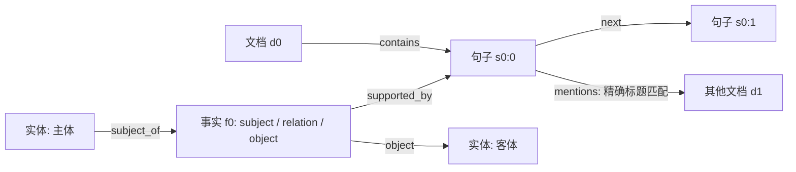

# API 图记忆实验

独立实现的 HotpotQA / LoCoMo 工具化证据图，默认使用 BAAI/bge-m3 dense 检索。参考了 PGMem 的图存储/检索分工，但没有复制其节点分类、更新规则或代码；运行时不导入、不修改 `pgmem`。本阶段没有 CAPS 心理结构，也没有 RL，管理策略来自 API 模型和提示词。

## 快速运行

在 CAPS 目录中运行：

```bash
uv sync --locked
# 本项目已下载模型；首次在另一环境运行时才需要下载，约 2.3 GB。
uv run python -m graphmem.download_model
uv run python -m graphmem inspect --limit 1
uv run python -m pytest -q
uv run python -m graphmem run --dataset locomo --limit 12 --seed 42 \
  --embedding-device cuda --output runs/my_locomo12
```

使用说明中的 `my_locomo12` 为新实验目录。已完成实验请直接查看报告；同一目录再次运行需加 `--resume`，更改代码/配置后应使用新目录。

现有 `.env` 中使用三个变量：`OPENAI_API_KEY`、`OPENAI_BASE_URL`、`OPENAI_MODEL`。程序在 base URL 后添加 `/chat/completions`，要求模型支持原生 function/tool calling。环境变量优先于 `.env`。不会自动改用另一个模型或端点。密钥、端点明文不会进入 manifest；`.env` 和运行结果均已加入 `.gitignore`。

程序只读取本地数据；`run` 会向你配置的 API 发送抽样问题和对应候选文档，并产生 API 用量。`inspect` 与测试不访问 API。默认读取 `datasets/hotpot_qa/distractor/validation-00000-of-00001.parquet`，不是 fullwiki 全维基检索。

## BGE-M3 检索

默认 `--retrieval bge-m3 --embedding-backend local`。使用官方固定 revision `5617a9f61b028005a4858fdac845db406aefb181` 的 XLM-R backbone，以 CLS pooling 生成 1024 维向量，再 L2 归一化并计算 cosine；无需添加 query instruction。本次只使用 dense embedding，没有实现 M3 的 sparse 或 ColBERT 输出。配置依据 [BAAI 模型说明](https://huggingface.co/BAAI/bge-m3) 与下载的 `1_Pooling/config.json`。

模型存放于 `models/bge-m3`。`--embedding-device auto` 根据当前进程可见设备选择 CUDA 或 CPU；要保证使用 GPU，明确传 `--embedding-device cuda`，不可见时会报错。本机已在 RTX 5060 Ti 上通过真实推理，CUDA 使用 FP16，CPU 使用 FP32。默认 batch size 8、最大长度 1024 tokens；超过长度会明确报错，不截断文本。可用 `--embedding-batch-size` 和 `--embedding-max-length` 调整，模型上限为 8192。

硅基流动 API 模式也已通过真实请求验证：

```bash
uv run python -m graphmem run --dataset locomo --limit 12 \
  --embedding-backend api --embedding-model BAAI/bge-m3 --output runs/my_locomo_api12
```

默认复用 `.env` 的 chat API key/base URL，调用 `/embeddings`。可通过 `EMBEDDING_API_KEY`、`EMBEDDING_BASE_URL` 单独配置；模型支持 `BAAI/bge-m3` 与 `Pro/BAAI/bge-m3`，没有自动替换模型。接口参考 [硅基流动官方文档](https://api-docs.siliconflow.cn/docs/api/embeddings-post)。本次 QA 对照实验使用本地 GPU embedding。

SQLite 向量缓存位于 `.cache/embeddings.sqlite`，按模型、revision、设备/精度、长度配置和文本内容哈希隔离；不存明文。新增和修订事实按新的文本取向量，撤回事实不再进入候选集合。缓存跨题共享的是向量，不是图事实或回答状态。开始问答前统一预计算所有抽样会话的源节点向量，避免把首次索引成本误当作某个管理策略的成本。

`embedding_usage.json` 单独记录编码数量、缓存命中、本地编码时间/输入 tokens 或 embedding API 用量；问答表的 token 列仅计算 chat API，不能把两者混为一项。`--retrieval bm25` 保留原始词法检索供消融，不初始化 embedding 模型。

## LoCoMo 数据与评分

`--dataset locomo` 读取 `datasets/locomo/data/locomo10.json`。每个 session 是文档，每个对话 turn 是原文节点，保留时间戳、说话人和原始 `dia_id`。提供的 `blip_caption` 作为图片文字描述，不下载图片。数据中的 `qa` 标签、`event_summary`、`observation`、`session_summary` 不进入模型输入或索引。

LoCoMo 静态图增加 speaker—turn 连接和相邻 session 连接。内部工具继续引用 `s0:0` 形式的 ID，预测同时输出对应的 `dialogue_ids`（如 `D1:1`）。每次问答从同一会话的完整原始对话重新建图，各模式及问题独立；当前是离线会话记忆 QA，没有跨问题积累模型生成事实，也没有在线逐轮构建/压缩记忆。

默认在类别 1–4 内均衡抽样；类别 5 的对抗题可用 `--categories 1 2 3 4 5` 加入，不会把 `adversarial_answer` 当成可回答 gold。默认只运行 `flat`、`static_graph`、`managed_graph`，避免当前 7B 模型强行容纳完整长对话。若显式选择 `full_context`，仍受上下文预算限制，无法容纳时记为失败。

Answer F1 与本地官方 `task_eval/evaluation.py` 核对一致：Porter stemming；类别 1 按逗号拆分多答案并计算每个参考项的最佳 F1；类别 3 使用分号前的答案；类别 5 判断指定的拒答短语。LoCoMo 表中的 EM 和 evidence F1 是辅助指标，Joint F1 不报告。少量原始证据 ID 含合并、补零或冒号格式问题，适配器修复明确可解析的格式，无法映射的证据保存在 `unresolved_evidence`；该问题的证据指标不计入，答案评分仍保留。`metric_counts` 显示各指标分母。

类别分数保存在 `category_scores`。同一会话的题目可能相关，因此 LoCoMo 配对 bootstrap 以会话为重采样单位；小样本仍不足以确认稳定收益。原始数据与评分代码见 [LoCoMo 官方仓库](https://github.com/snap-research/locomo)。

## 对照条件

| 模式 | 可见材料与工具 | 检验目的 |
| --- | --- | --- |
| `full_context` | 一次提供全部候选句子；只能调用 finish | 常规全文问答参考 |
| `flat` | 初始只有问题和标题；搜索/分页读取原文 | 普通工具检索基线 |
| `static_graph` | flat 工具 + 图搜索、邻居展开；禁止修改 | 图访问的作用 |
| `managed_graph` | static_graph 工具 + 新增、修订、撤回事实 | 允许模型管理图记忆的作用 |

四组使用相同抽样、模型、温度、最大调用轮数和工具次数；full_context 的实际输入与花费当然不同。静态图与管理图起始结构相同，管理图额外获得写工具及使用提示。它们的差异包括这些提示和工具选择开销，不能当成纯图拓扑的因果实验。按题轮换模式执行顺序。

```bash
# 只运行两个最直接的对照条件
uv run python -m graphmem run --limit 50 --seed 7 \
  --modes static_graph managed_graph --output runs/graph50

# 中断后续跑：必须保持代码、模型、数据、抽样和预算配置一致
uv run python -m graphmem run --limit 50 --seed 7 \
  --modes static_graph managed_graph --output runs/graph50 --resume
```

默认每题每模式最多 12 次模型调用、32 次工具调用、每次最多 2048 个输出 token。输入以序列化消息的 120000 字符为保护上限，并非精确 tokenizer 限额。到达上限会记录失败，不悄悄截断证据。最后一轮只允许 finish。HTTP 429/5xx 和传输错误最多尝试三次；重试可能重复计费。可通过 `--max-rounds`、`--max-tools`、`--max-tokens`、`--max-input-chars`、`--timeout` 调整。

若因 429 停止，可在保持原代码与默认数据/模型路径的情况下使用 `uv run python scripts/resume_rate_limited_run.py runs/你的目录 --interval 7`：保留限流失败 episode 到 `attempts/`，跳过成功 episode，以较慢速度重试；请求时间和冷却事件单独写入 transport 日志。该辅助脚本只恢复 429 错误，并核对原始代码哈希，不修改策略或提示词。正式结果与失败尝试用量应分开查看。

## 图结构与操作

每道题重新建图，模式之间、问题之间互不共享记忆。原文节点不可修改，模型生成的事实可修改且可追溯。



- 初始边由文档结构、句子顺序和跨文档的精确标题提及确定，不读取标准答案或 supporting facts。标题提及是一个简化起点，不是完备实体链接。
- `search_sources(query, limit)`：默认 BGE-M3 检索原始句子/对话 turn；`read_document(document_id, start, count)`：分页读取。
- `search_memory(query, limit)`：搜索原文、实体和有效事实；`expand_memory(node_id, hops, limit)`：有界双向 BFS，返回节点与边并标记是否截断。
- `add_fact(subject, relation, object, evidence)`：创建主体—关系—客体事实，自动连接实体和来源。
- `revise_fact(fact_id, subject, relation, object, evidence, reason)`：保留事实 ID，替换事实及证据边，保存前后版本。
- `retract_fact(fact_id, reason)`：软删除，保留审计事件；不删除原始证据。
- `finish(answer, evidence)`：输出最短答案片段及句子 ID；ID 在本地转为官方要求的 `[title, sentence_index]`。

写入和最终引用只能使用当前 episode 中已经通过工具读到的句子。这个约束验证来源存在且已读，**不验证句子在语义上真的支持模型的事实**；事实明确标为模型断言。实体仅按规范化名字合并，暂不支持别名消歧。事实节点上限为 64，检索与展开有返回数量上限。

第一版保留完整工具对话，不进行上下文压缩，因此测的是单题内主动组织和访问图证据，不能据此声称长期记忆有效。图快照保存供审计，但不会自动成为下一题的先验。

## 结果与复现

每次运行生成：

- `manifest.json`：数据与代码 SHA-256、模型、样本 ID、预算和随机种子；没有密钥。
- `episodes/*.json`：预测、状态、评分、完整 API 可见消息、工具轨迹、最终图和修改事件。文件采用临时文件后原子替换，已完成 episode 可恢复。
- `gold.json`：单独保存的本地评测标签，绝不传给 agent。
- `predictions_<mode>.json`：官方 HotpotQA evaluator 接受的 `answer`/`sp` 格式。
- `summary.json`、`report.md`：汇总答案 EM/F1、支持证据 EM/F1、joint EM/F1、状态、tokens、工具调用及管理图相对基线的配对差值。`memory_diagnostics` 记录实际写入次数和派生事实被检索/展开的次数，避免只看接口是否存在。
- `embedding_usage.json`：与 chat 用量独立的 embedding/缓存统计。无操作 resume 保留原始统计，有新增工作时额外保存 `embedding_usage_resume.json`。

评分定义对齐 [HotpotQA 官方 evaluator](https://github.com/hotpotqa/hotpot/blob/master/hotpot_evaluate_v1.py)，含 yes/no/noanswer 特殊处理。失败 episode 以空预测计入已执行样本；未执行样本不伪装成已评测，报告同时列 completed/planned。API/协议故障会停止后续调用并保留已有结果。resume 跳过所有已保存 episode（包括失败项）；若要重测失败项，请新建输出目录。

配对 bootstrap 使用 2000 次重采样，区间仅反映当前题目样本波动。小样本区间可能退化；温度为零也不能保证供应商完全确定性。真实 API 的模型权重/服务变化不受本地 SHA 控制。API 缺失 usage 时标记 `usage_complete=false`；报告 token 数是供应商返回值，不估算金额。

先用小样本检查工具使用和错误，再扩大评测。若管理图只新增事实但从未读取这些事实，或收益只来自额外模型调用，应把这些情况单独报告。要进一步验证图连接本身，可增加无边事实存储、打乱边、固定工具预算等消融。

## 文件位置

`graphmem/data.py` 隔离公共输入与标签；`graph.py` 存储、检索和变更；`embeddings.py` 本地/API BGE-M3、缓存与向量排序；`download_model.py` 固定版本下载；`api.py` chat 传输；`agent.py` 工具与决策循环；`metrics.py` 两个数据集的评分；`__main__.py` 抽样、运行、恢复与报告。测试使用模拟 API，不消耗额度。

数据来源：[hotpotqa/hotpot_qa](https://huggingface.co/datasets/hotpotqa/hotpot_qa)，数据许可见本地数据集 README。
