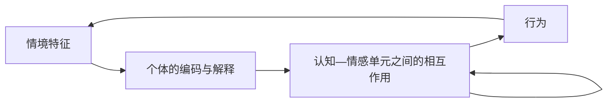

# CAPS 理论初读笔记

整理日期：2026-10-09。本文为概念梳理；尚未进行系统综述或对现有数据集的适配评估。

## 理论对象

CAPS 通常指 Cognitive-Affective Personality System，也称 Cognitive-Affective Processing System，可译为“认知—情感人格系统／加工系统”。它属于人格与社会认知研究，由 Mischel 和 Shoda 在 1995 年提出。

核心主张：行为会随情境改变，但变化可以有稳定的个体模式。“人格稳定”可以体现在某人的 if–then 情境—行为关系中，同时也体现在平均行为倾向中。来源：[1995 原文](https://psychology.columbia.edu/sites/default/files/2016-11/246.pdf)，pp. 246–250。

## 五类认知—情感单元

原文 Table 1（p. 253）列出五类单元，类别之下可以有许多具体表征：

| 类别 | 简要含义 |
|---|---|
| 编码与解释 | 如何理解自己、他人和情境 |
| 预期与信念 | 预期结果，对世界和自身能力的判断 |
| 情感 | 情绪、感受与相关生理反应 |
| 目标与价值 | 想达到或避免的状态 |
| 能力与自我调节计划 | 可执行的行为、策略和调节方法 |

这些单元相互促进或抑制，情境激活其中一部分，再影响行为。理论描述的是心理层面的功能关系。来源：[1995 原文](https://psychology.columbia.edu/sites/default/files/2016-11/246.pdf)，pp. 253–255。

## 情境的心理意义与反馈

情境应按其对个体的心理意义来理解：同一句话可能被理解为帮助或拒绝。人的行为又会改变他人的反应与后续情境。

图为概念示意，内部加工包含循环。拒绝敏感性研究提供了具体应用：担心被拒绝的人可能通过迁就避免拒绝，感到被拒绝时却出现敌意；自我调节能力可能缓冲反应。来源：[Ayduk & Gyurak, 2008](https://pmc.ncbi.nlm.nih.gov/articles/PMC2772175/)，CAPS Approach 与后续拒绝敏感性讨论。

## 两种不同的证据

- **行为观察**：1994 年夏令营研究报告了稳定而具有个体差异的情境—行为模式。这支持把行为变化的模式纳入人格描述。来源：[研究摘要](https://pubmed.ncbi.nlm.nih.gov/7965613/)。
- **计算模拟**：2002 年研究用 5 个输入单元、10 个循环加工单元、5 个输出单元模拟人格。固定连接仍可形成不同吸引子；两个人的网络耦合后可产生新的互动模式。固定权重的模拟展示了机制的可能性，不能直接认定为人的真实网络。来源：[2002 全文](https://depts.washington.edu/shodalab/wordpress/wp-content/uploads/2015/05/2002.StabilityDistinctiveness_Shoda.pdf)，pp. 318–324。

## 对后续 CAPS 项目的启发（我们的推论）

若用于个性化模型或智能体，首先需要明确人物、情境、行为和时间的记录单位，再提出可检验的机制假设：

1. 用同一人物在多种情境下的重复记录，检查条件性反应能否重现。
2. 分别表示人物的长期参数与当前状态，避免把一次情绪变化当成人格变化。
3. 为情境解释、预期、情感、目标、自我调节设计操作性定义；五个字段本身不足以构成 CAPS。
4. 与仅用平均偏好或静态人格描述的基线比较，检验机制是否增加预测价值。
5. 条件性行为预测正确，仍不等于内部机制已获验证；应考虑中介测量、替代解释或干预证据。

这些是后续研究建议，并非原论文给出的 LLM 算法。目前尚未读取或改动 datasets 的数据内容。
